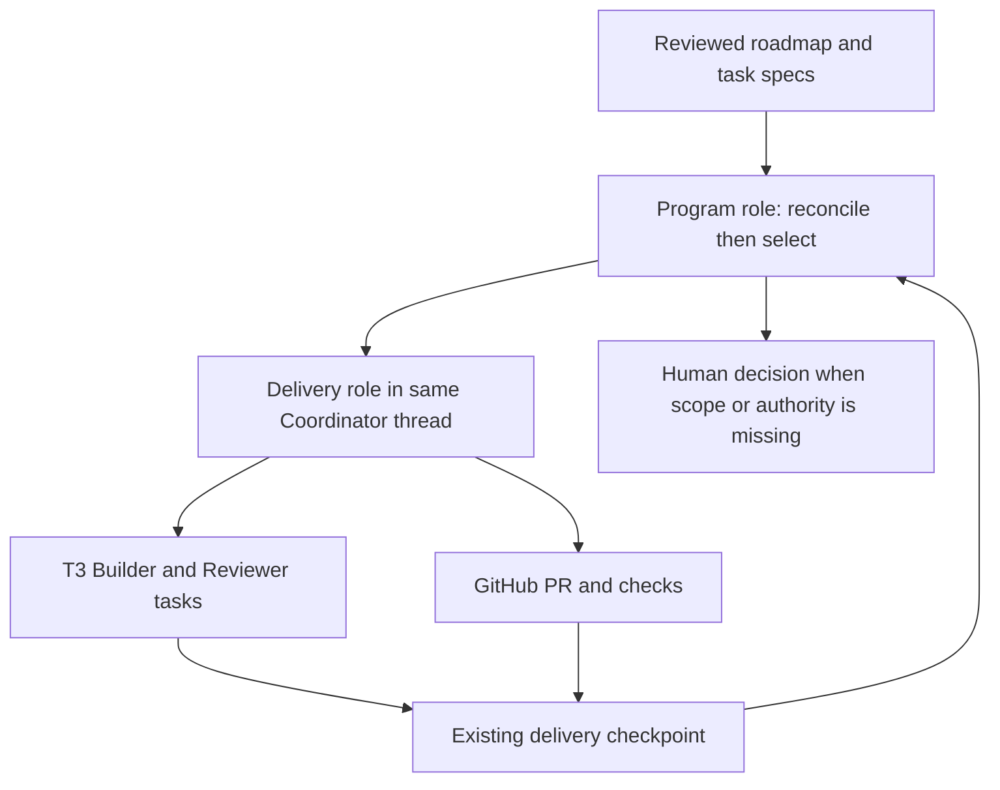

# Program Coordinator proposal — decision draft, not implementation

2026-11-08. Baseline main 2da639ac9c3dc4c9178462b79850f30e29c07d45. PR14 corrected head d37b00877895eca3036639c5ddcb73ee09112de2 remains draft. No runtime, settings or permissions changed. Repository task-planning procedure applied; this document proposes work and grants no execution authority.

## Source of the original five milestones

Recovered original user assignment from T3 thread <t3-thread://v2/6cc0ae12-6b04-4e79-8380-9e094e1b9e21/b657cac2-015e-442c-aa07-062b110c447a>, user message at position 20 (2026-11-05). Read the earlier full requirements at position 0 and distribution amendment at position 13 as well. This is the actual milestone source; docs/orchestration/graph.json is explicitly an example and docs/onboarding/integration-plan.md covers only one later subproject.

Evidence classes below: implemented = inspected source/tests and merged history; historical runtime = recorded evidence, not rerun in this design turn; live = host/tool query or execution in this Coordinator sequence. No blanket production-readiness claim.

## Original Milestones 1–5 inventory

| Original milestone | Completed evidence | Missing or limited | Assessment |
| --- | --- | --- | --- |
| 1 Graph and Handoff | PR5 merged 9c1c16c: handoff.py strict schema, current-head validation, negative tests and context recovery docs. PR6 merged 208c659: graph.py DAG validation/rendering, duplicate/cycle/missing/self-dependency and ownership guards, deterministic readiness, graph/handoff tests. | graph v1 nodes have only id/title/status/depends_on/owns; original rich scope, acceptance, routing, risks and evidence fields are not represented in graph. Handoff v1 also omits several original dedicated fields (parent goal, worktree, changed files, decisions/next action); those currently live in briefs/prose. No real roadmap or authoritative completion collector; sample status is not execution evidence. | Core validators implemented; broader planning/context contract partial. Extend through referenced task specs rather than duplicate fields everywhere. |
| 2 Agents and Skills | PR8 merged 95ac900: six canonical harness/skills procedures and deterministic .agents/.claude copies; skills.py structure/sync/link checks; roles and context conventions. Readiness records report Claude fresh-session discovery/invocation and Codex catalog visibility. | Codex fresh runtime invocation remains unproved in historical checklist; reading files is not provider-native invocation. Provider copies do not enforce tools/permissions. No need for permanent extra role agents. | Implemented and filesystem-tested; runtime activation partially verified. |
| 3 MCP and Model Routing | PR7 merged 133a640: tool inventory, routing policy, ADR0002 preserves T3 control plane. Current capabilities query advertises task delegation, cancellation, thread lineage/read, scheduled tasks, PR integration; Codex/Claude available locally. Real Windows Codex and remote Ubuntu review executed in recent PRs. | Optional MCP executions and comparative model benchmarks untested/deferred by original scope. Dated inventory needs reconciliation when used. Role prose does not narrow actual full-access environment. Same-provider/model non-author review executed; cross-provider equivalence is not established by these runs. | Policy/inventory delivered; optional integrations require separate setup/testing. Security enforcement remains an explicit limitation. |
| 4 Portable Distribution | PR9 merged 8d45c91; PR10 merged fb06ef5: pinned committed-blob onboarding, init/check/upgrade/dry-run/rollback, collision/drift handling, disposable Git tests, START/templates, no calculator copying. Target need not use Python; installer runs from harness Python/uv environment. | No authorized real target adoption. No independently versioned release/signature/trust service: exact commit pins provide version identity, not authenticity. Standalone installed assets tested historically; no global runtime promised. | Core portable mechanism implemented with local integration coverage; real adoption and publisher trust decisions pending. |
| 5 Integration and Readiness | PR10/11 (3b0086d) evidence checklist and disposable integration coverage; policy gate and host-protected merges. PR12 (1225c72) read-only GitHub observations collector. PR13 (2da639a) checkpoint lifecycle. PR14 real red CI -> automatically delegated correction -> green CI -> Ubuntu review, plus fresh-process state checks recorded locally. | PR14 not merged. Enforced reviewer restrictions not established; checklist preserves negative probe. CI watch wake, real remote crash/ambiguous-dispatch recovery, full cross-provider coverage remain untested. Collector intentionally does not authenticate all delivery conditions; Coordinator manually collects effective policy through host APIs. No current synthesized original-milestone roadmap exists. | Integration candidate demonstrated, not complete security/production qualification. Historical checklist rows must not be silently promoted by newer narrow evidence. |

Sources inspected: engineering-standard.md; t3-runbook.md; ADR0001/0002; graph.py/handoff.py/skills.py/onboard.py/controller/checkpoint.py and associated tests; docs/orchestration/{roles,graph-schema,context-pack,model-routing,skills}.md; onboarding implementation/README/integration plan; readiness checklist and current PR12–14 local reports. GitHub PR list independently confirms PR5–13 merged, PR14 open. Historical test counts remain historical. This inventory is not a complete audit of every sentence of the original specification.

## Smallest architecture

One active Coordinator thread performs two logical roles. Program role owns scope, milestone DAG and task selection; Delivery role executes one bounded task through existing Windows Builder/CI/Ubuntu Reviewer workflow. A role switch in the same thread is the default; no automatic nested Coordinator agent. Separate runtime only when concurrent deliveries or context isolation show a concrete benefit, with explicit delegation authority.

### Ownership of facts

- Proposed docs/program/roadmap.json is a real authored graph with stable milestone/task IDs and dependency edges; docs/program/tasks/<id>.md carries scope, exclusions, acceptance, risk, ownership, routing class, decision references and completion boundary. Do not copy the sample graph into it. Use existing graph.validate/readiness/render by projecting the task DAG to v1 shape; new program validation checks metadata references rather than weakening graph v1.
- Proposed trusted local program checkpoint, outside committed plan, stores plan revision/hash, active task/attempt, delivery checkpoint reference, dispatch intent/native IDs, completion evidence references and blockers. T3 owns execution status/transcripts; GitHub owns PR/check/merge facts. Existing delivery checkpoint owns head-bound evidence and retry consumption. Do not mirror task histories in roadmap JSON.
- Human-approved plan is scope, not blanket merge permission. A validated handoff is not authorization. The Program role cannot convert a completion summary into verified milestone completion. It reconciles authoritative records through Delivery role, then updates a derived view.

### Selection and dependency semantics

On initial request or native wake: read plan revision and local checkpoint, reconcile active T3/PR identity, invalidate changed-head evidence, then compute eligible tasks from verified dependency satisfaction. Use explicit approved priority then stable task ID as tie-break; one active delivery initially. Unknown or blocked evidence blocks the affected dependent tasks only. No periodic scheduling, timer, queue, database or custom remote client.

Each dependency states whether it needs report-ready or merged completion; default code dependencies require verified merged main commit. Research/design tasks may use accepted-artifact completion. Do not treat CI success, PR closed without merge, or Draft readiness as merged. Failed, stale, superseded or cancelled tasks never satisfy dependencies automatically. Human-approved replanning changes IDs/edges and invalidates affected cached selections.

Each task has approved/not-approved execution scope and an explicit architectural-decision prerequisite. Executable approved tasks move directly to Delivery role without asking user to relay output. After authorized task completion, Program role can choose the next already-approved task on the same wake. This is agent orchestration using native T3 tools, not Python code launching a hidden agent. If no wake/event exists the agent is not claimed to be always running.

### Recovery and control

Persist selected task and stable dispatch intent before native call; persist returned ID afterward. On resume reconcile those IDs and branch PR before dispatch. Completed task with still-live child work is not terminal. Ambiguous dispatch blocks until native records resolve it; clientRequestId is a reconciliation key, not an exactly-once guarantee. Local event replay returns existing state and never causes an external tool call. Single writer owns program state; no locks/multi-writer runtime in first milestone.

Task retry budget reuses Delivery checkpoint (default two corrections). Program must not reset budget by creating a new delivery ID. Escalation records failed acceptance, attempt count and decision needed; do not silently skip failed work. Architecture/framework/permission/security/production changes outside approved plan become awaiting_decision, with options and consequences. Merge authorization remains separate per approved scope; this design grants none.

Roadmap completion is derived from accepted task outcomes and evidence freshness. Cross-milestone progress reports group complete, active, dependency-blocked, awaiting_decision and awaiting_authorization. Same-model independent review remains non-author evidence, not formal host approval or permission enforcement.

## Decisions needed before implementation

| Choice | Recommended | Alternative/trade-off |
| --- | --- | --- |
| Runtime roles | Same Coordinator thread, serial delivery | Separate Program/Delivery runtime agents isolate context but add handoffs, failure states and usage; unjustified initially. |
| Dependency completion | Code dependencies wait for merged commit; design tasks require explicit artifact acceptance | Report-ready dependencies allow parallel PR stacks, but need stack/base reconciliation and downstream invalidation. Defer stacks. |
| Authority | Automatically execute already-approved bounded roadmap tasks; ready/merge still require explicit applicable authorization | Per-task confirmation gives tighter control but interrupts autonomy; broad standing merge authorization is a separate user decision, not proposed default. |
| Roadmap priority | Explicit human-reviewed priorities plus deterministic ID tie-break | Agent reprioritization can optimize dynamically but risks scope drift; escalate material ordering changes initially. |
| Durable state | Versioned plan/task specs plus local reference-only execution checkpoint | All state in Git makes transient heads churn; SQLite/shared service adds coordination machinery. Local state needs backup/reconciliation and is not cross-machine transactional. |

## First bounded implementation milestone: PC1

Proposed scope: a pure stdlib program-plan validator and deterministic next-task selector, referencing existing task docs/graph/delivery checkpoint, plus runbook wiring for one serial task. Not a generic scheduler, merger, dashboard, multi-project adopter or agent hierarchy. No additional dependencies, global settings, credentials or production actions.

Implementation ownership: one Windows Builder owns new controller/program.py, tests/test_program.py, docs/program schema/real roadmap and runbook; existing graph/checkpoint APIs remain unchanged unless a justified minimal correction is separately reviewed. Coordinator owns local runtime evidence. Independent Ubuntu review of final head required.

Acceptance criteria:

1. Checked-in real roadmap identifies the five original milestones with evidence references and explicit gaps from this inventory, plus PC1 as proposed/in progress only after authorization. No sample completion assertions copied. Validator rejects duplicate/missing/self/cyclic edges, missing task specs, unsupported completion conditions and unsafe independent ownership using existing graph validation.
2. Pure selection returns one stable next approved task or explicit blockers. Tests cover failed dependency affecting only descendants, independent work remaining eligible, report-ready versus merged, awaiting decision/authorization, stale plan revision and superseded work. Unknown evidence fails closed; selected task never means authorized merge.
3. Reference checkpoint records active task, immutable delivery identity and plan revision. Resume/replay tests prevent a second delivery task/PR, preserve retry budget and block ambiguous native outcomes. T3/GitHub adapters remain operational Coordinator tool calls, not a second service.
4. CLI read-only check/next output and derived roadmap view are deterministic. Run locked full suite; no existing package behavior, CI/protections or portable installer asset mapping changes.
5. One later authorized bounded task is selected and handed to existing Delivery role through native tools, automatic results reconciled back to roadmap; fresh exact-head review and host CI evidence required. Report live proof separately from local fixtures. No merge without authorization. PC1 draft implementation PR first; do not self-certify a future live test now.

Exit: focused draft PR and precise readiness evidence. This document is local, uncommitted design work; PR14 head remains unchanged. No Program Coordinator implementation has started. User decisions above, especially authority and completion boundary, precede implementation.
