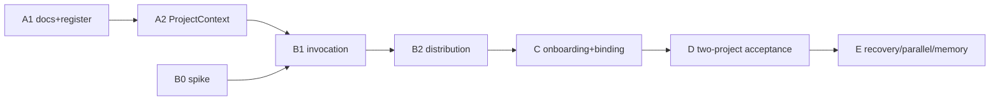

Status: research is done (committed-source inspection, external sources, host recheck). I'm writing the six outputs now.

# Universal modernization research: six outputs (proposed text only)

**Baseline.** Host `main` was `e7791174e3a5ed46f4834d8d0dc5b076f7e19d00` before and after research. I checked with `git ls-remote`. PR14 head is `d37b00877895eca3036639c5ddcb73ee09112de2`, untouched. No baseline change.

**Method.**
- I did **inspection only**: `git show e779117:PATH` and `git ls-tree`. I ran no project code and no tests, and wrote nothing.
- Every "tests pass" claim below comes from local readiness documents, not from me.
- Context7 was not needed. I answered no library-API questions, and runtime facts come from the cited official pages.
- I did not read the installed native schema (it wins over any doc). I did not read `docs/readiness/*` beyond the P3 JSON head and `portability-handoff.md`.

---

## 1. Architecture audit

### 1.1 What works (inspected, not executed)

| Capability | Evidence | Strength and limit |
|---|---|---|
| Deterministic approved-task selection | `controller/program.py:81-126` | Gates on approved, decision, dependencies, scope. Never dispatches (`merge_authorized=False`, :126). |
| Immutable plan→delivery binding | `program.py:129-140` (exclusive `open(...,'x')`) | Replay-safe. Binding hashes roadmap + spec bytes (:42-50). |
| Single-writer checkpoint, receipts | `checkpoint.py:68-132, 135-150` | Strict closed fields (:27). Head change clears CI/review (:111-112). Atomic fsync replace. One local writer. |
| Persist-intent-before-native-call | `lifecycle.py:18-36`, `continuation.py:85-89` | Orphans are recovered but never re-granted dispatch (:83-85). |
| Serial succession + replay journal | `continuation.py:24-99` | Distinct intents and paths enforced (:76-82). |
| Read-only GitHub evidence | `github.py:103-139` | Repo-generic (`REPO` regex, :14). Always blocked today: protections and review are `None` (:104-107), so it never grants merge. |
| Bounded M1 task context | `task_context.py:53-121` | Revalidates identity, head, plan hash, source hashes. `authorizes=False` (:120). Carries `repo` (:14, :76). |
| Routing as pure validator | `routing.py` (891 lines), `harness/policies/routing-v1.json` | Separate `project/repo/task/attempt` (:293, :435-439). Policy content-hash (:121, :472). Reviews reject other project/repo/task (:781). |
| Pinned, drift-checked onboarding | `onboard.py:110-124, 160-235` | Full-SHA blobs, hash manifest, rollback snapshot, pilot-repo refusal. Not a multi-file transaction (`docs/onboarding/README.md:90-95`). |
| Skill bundle validation | `skills.py:54-120` | Frontmatter, link and unsafe-text lint. `runtime_discovery: not_verified` (:165). |

### 1.2 What is missing or coupled (the gaps that matter)

| # | Finding | Evidence | Consequence |
|---|---|---|---|
| A1 | Milestones hardcoded to `M1..M5`. | `program.py:28` | Any other project's roadmap is rejected. This is PORT-02. |
| A2 | The Program/Delivery layer has **no project or repo identity**. | Roadmap fields are closed (`program.py:26-27`). Checkpoint fields are closed (`checkpoint.py:24-26`). Binding is `{plan_hash, task, delivery-abspath}` (`program.py:131`). | Two projects with identical roadmap and spec bytes get the same `plan_hash`, and are told apart only by file path. Identity exists only in the routing sidecar (`routing.py:446`) and task-context (`task_context.py:76`). This is PORT-03 at the layer that selects work. |
| A3 | Absolute paths are persisted as state identity. | `program.py:131`, `continuation.py:29-35` | State is not relocatable. A checkout move breaks the binding (`binding differs`). |
| A4 | Hardcoded default `docs/program/roadmap.json`, and the root is `Path(plan).parent`. | `program.py:146,153`, `lifecycle.py:87`, `continuation.py:105` | Spec paths resolve against the roadmap's directory. `task_context.py:89,101` instead requires the plan inside `root`. The two conventions coincide only when the roadmap sits at repo root or in a subdir. |
| A5 | Checkpoint v1 is closed and cannot take new fields. | `checkpoint.py:27,31` | ADR 0003 chose a sidecar for this reason. Adding `project`/`repo` needs v2 plus a v1 reader. |
| A6 | Git SHAs are 40-hex only. | `handoff.py:21`, `github.py:15` | SHA-256 repositories are unsupported. The artifact 64-hex special case is in `program.py:62`, `lifecycle.py:61`. |
| A7 | CLI advertises dead commands. | `lifecycle.py:86` lists `reevaluate`/`resume`, but :94 routes every non-prepare/attach command to `reconcile`. | Read from the code, not run. Reading it, those commands would fail at `**args`. The corresponding docs in `docs/program/*` are drift. |
| A8 | **Onboarding distributes validators and docs, not the control plane.** | `onboard.py:93-101` maps only `graph/handoff/gate` plus docs, skills and START. `START.md:14-16` offers only graph/handoff. `harness/distribution/README.md:3-13`. | INV-01 ("full workflow, not just skills") is unmet. Controller, routing, `task_context` and policy are not distributed. |
| A9 | Controller imports use absolute package paths. | `routing.py:20-21`, `task_context.py:9-10`, `lifecycle.py:6` (`agent_workflow_pilot.*`). `pyproject.toml` has no `[project.scripts]`. | Invocation requires the harness environment (`uv run --locked python -m ...`, `docs/program/README.md:12`) run from the harness checkout. How to run it **against a target cwd** is untested (see 4-B). |
| A10 | Managed manifest uses set-equality on known path sets. | `onboard.py:152-153`, legacy tier :104-107 | Adding assets requires a new allowed set and a legacy tier. A naive addition breaks `check` for existing installs. |
| A11 | The distributed docs carry known drift (DOC-P3-03). | `onboard.py:20` ships `orchestration/model-routing.md`. Its :13 row still says planning/architecture auto-switch ("yes, Sonnet and Sol only"), but `routing.md:109-112` says that is caller choice. | The drift propagates into every adopted repo. |
| A12 | CI runs only `uv run --locked pytest` on ubuntu. | `.github/workflows/ci.yml:12-20` | No skill-copy sync check, no `onboard check`, no docs/link drift gate (CONT-01, DOC-01). Windows results are local claims only. |
| A13 | Three committed skill copies plus a fourth installed. | `harness/skills`, `.agents/skills`, `.claude/skills` (committed), `.agent-harness/skills` (installed, `onboard.py:97-99`). | Drift is detected only by `skills.py` and its tests. |
| A14 | Approval flags live in a repo-committed file. | `roadmap.json`: `approved`/`decision` booleans (`program.py:101-102`). | A worker PR could edit them. Protection is the Coordinator reading roadmap from the trusted host ref, plus `plan_hash` binding. This is an implicit rule and needs writing down (see invariant U6). |
| A15 | README still claims "No application behavior yet". | `README.md:3` | Stale next to the 18 modules. Pilot calculator code lives in the same package namespace (`calculator.py`, `statistics.py`, `string_normalization.py`). |
| A16 | The roadmap mixes pilot reality and demo. | `roadmap.json` revision `dynamic-routing-approved-2026-11-09`, 18 tasks (m1-core…pr14, pc1–3, dynamic-routing) | `dynamic-routing` is tagged `milestone: "M3"` (squeezed into the enum) even though it is a new milestone. |

### 1.3 Explicit unknowns (not proven by anything I read)

- Real quota exhaustion, a real remote crash, and exactly-once dispatch.
- Ubuntu reviewer isolation, and whether a target repo can run the controller from the harness install.
- Codex native skill activation. Claude discovery is historical only.
- Whether `uv run --project <harness> ...` with the target as cwd resolves `docs/...` and imports correctly. I would have to run it, and I did not.
- The local evidence layout for two projects.

**Do not rebuild the Coordinator.** The architecture is one Coordinator with logical Program and Delivery roles on native T3 execution (`docs/plans/program-coordinator-design.md:25`; ADR 0002 §2). Everything below is seams, not a new runtime.

---

## 2. Proposed universal contract (versioned, inert)

**Proposed path:** `docs/contract/universal-contract-v1.md`. It is a reference document, **not** referenced by `AGENTS.md` or `CLAUDE.md`, and **not** in the `onboard.py` `DOCS` list until Stage B authorizes it. Its job is to be linked from the register, not loaded. Pilot-side `AGENTS.md` stays a short index (Master Recovery Phase 1).

Status line: *proposed; grants no authorization; supersedes nothing; installed schema/live state wins on conflict.*

### 2.1 Invariants, each with a validator or acceptance test

`Exists` = a check I saw in committed source or tests. `Absent` = proposed, with the stage that adds it.

| ID | Invariant (short) | Validator / acceptance | Status |
|---|---|---|---|
| U1 | **Repo-agnostic.** Target repos need not use Python/uv. | Onboard test with a non-Python disposable repo. Controller invoked without target Python. | Partial: `onboard.py` validators are standalone (`START.md:14-16`). Controller path **Absent** (B). |
| U2 | **Identity quad.** `project` (slug), `repository` (`owner/name`), `task`, `attempt` are distinct and never inferred from each other. | `routing.py:293,435` exist. A `ProjectContext{project, repo, root_id}` verifier at Program/Delivery layer is **Absent** (A). | Partial |
| U3 | **Project-owned roadmap.** Milestone IDs are project-defined strings. | Pattern-validated IDs, positive tests with `alpha`, `phase-2`, no `M*` literal. | **Absent** (A), `program.py:28` |
| U4 | **No cross-project authority.** Evidence, context, checkpoint, quota, review of project A never satisfies B, even if task names, SHAs or filenames match. | Two-project negative suite: same task id, same plan bytes, different `project`/`repo` → reject. | Routing layer exists (`routing.py:781`, `test_cross_project_stale_...`). Program/Delivery layer **Absent** (A, D). |
| U5 | **Shared installation, per-project config and state.** Shared: code, skills, policy files (versioned, pinned). Per-project: roadmap, specs, approvals, checkpoints, sidecars, evidence, usage readings. | Layout validator: state paths must be under a project-owned state root. Shared tree is never written. | **Absent** (A defines the layout, B enforces) |
| U6 | **Approval ≠ selection ≠ merge.** Approval is read from a controller-trusted ref (host default branch), never from a worker's branch or PR. Merge is a separate explicit act. | `program.py:101-102` and `merge_authorized=False` exist. A "roadmap read from trusted ref" assertion in the controller procedure is **Absent** (docs now, validator in A). | Partial |
| U7 | **Bounded reconstructible M1 context.** Handoff/1 plus task-context/1. No second context format. Reconstruction revalidates sources and identity, and never grants authority. | `task_context.reconstruct` (:53-121) and tests exist. | Exists |
| U8 | **Native T3 reuse, no second scheduler.** | ADR 0002 §2. Test: no module imports `subprocess` beyond `github.py`/`onboard.py`. Ban-list check **Absent** (optional). | Policy only |
| U9 | **Provider independence + cross-provider review.** Author provider ≠ reviewer provider, non-author, exact head. | `validate_reviews` (`routing.py:741-790`). Gap: ROUTE-P3-01. | Exists, with a gap |
| U10 | **Serial writer, intent-before-call, ambiguous = held.** Replay never grants dispatch. | `checkpoint.apply`, `continuation.advance`, `routing.apply/recover`. | Exists (local single writer) |
| U11 | **Replay safety.** Event IDs bind payload. Reuse with a different payload raises. | `checkpoint.py:78-81`, `continuation.py:48-51`, routing receipts. | Exists |
| U12 | **Unknown ≠ pass.** Missing quota, protections, review → blocked. | `github.py:104-107`, `gate.blockers`, `routing.usage_state`. | Exists |
| U13 | **Head-bound evidence.** New head invalidates CI/review. | `checkpoint.py:111-112`. | Exists |
| U14 | **Explicit approval and protected merge.** `--match-head-commit`, no admin, never delayed auto-merge. | `engineering-standard.md:19`. Controller procedure, not code. | Documented |
| U15 | **Backward-compatible migration.** Old checkpoint v1, handoff/1, task-context/1, routing sidecar/1 stay readable. New writers are explicit. A policy change = new record with a linked predecessor. | Fixture suite loading historical v1 records through a compat shim. | **Absent** (A) |
| U16 | **Provenance, not trust.** A pin is a full SHA plus content hashes. Origin and publisher trust is a separate recorded human decision. | `onboard.py:111-113`, `docs/onboarding/README.md:50-60`. Trust-decision record field in install manifest **Absent** (B, optional). | Partial |
| U17 | **Thin instructions.** The universal contract is not auto-loaded. Skills load on demand. | Docs rule. Optional size check on any onboarding-installed instruction file (B). | Policy |
| U18 | **Secrets never in prompts, evidence or logs.** | Not machine-checked anywhere I read. Proposed: a lint over saved evidence JSON for token patterns (deferred, D). | **Absent** |
| U19 | **Honest evidence classes.** Every claim is labelled mocked / local-file / live-native / host. | Convention in `routing-gap-register.md:3`. A claim checker is **Absent**. | Convention |
| U20 | **Isolation not asserted.** Reviewer read-only and project separation are never claimed unless demonstrated. | Documentation rule + Stage D evidence template field `isolation_evidence`. | Policy |

### 2.2 Version rules

`universal-contract/1`. Additive changes stay at /1. Any change to a validator's accepted records bumps the schema of that record, not the contract. Contract changes alter no active approvals, routing targets or checkpoint formats.

### 2.3 Required identity fields (proposed, minimal)

```
project   : slug [A-Za-z0-9][A-Za-z0-9._-]{0,63}   (handoff.py SLUG already exists)
repository: owner/name                              (handoff.py REPO, github.py REPO)
root_id   : sha256(project + "\0" + repository)     (controller-computed, in the new state header)
```

`root_id` is a derived tag so a state header can be compared cheaply. It adds no authority.

---

## 3. Consolidated gap and priority mapping

### 3.1 Register recommendation (one path)

**Canonical register: `docs/readiness/routing-gap-register.md`** (committed on main).
- Reasons: ADR 0003:32 and `routing.md:98` already link it by path, and it is the only committed register.
- Add sections for the Master Recovery IX IDs and the four P3 IDs, and a header line: "Current register as of ⟨main SHA⟩".
- Do **not** rename it in this cycle (avoids broken links).
- Do not create another register.

**Supersession and links:**
- `UNIVERSAL_AGENT_HARNESS_MASTER_RECOVERY_...md` §IX/§23: keep as the *historical priority source*. Add one line at its top: "live status lives in docs/readiness/routing-gap-register.md".
- `docs/readiness/dynamic-routing/p3-gap-register.json` (local, Coordinator commit `f855c01`, uncommitted on main): its four rows are copied **by ID** into the canonical register with their source/evidence/trigger/owner text. The JSON stays as retained evidence. It is not authoritative.
- `portability-handoff.md` and `pr-*-delivery-status.md`: dated evidence, linked, never edited in place.
- The historical "review pending" row (register line 8, ROUTE-02) is replaced by "partial → delivered with exact-head non-author reviews per local `review-*-86fefa4-terminal.json`". Only with the cited local files: they are the evidence, and I did not open them.

### 3.2 Open-gap table

Authorization: **none of these is authorized to implement**. Only `m1-gap`, `pc1–3`, `pc3-a/b` and `dynamic-routing` are `approved:true` in `roadmap.json`, and they are delivered/merged per local records. `m2-gap`..`m5-gap`, `m*-core` and `pr14` are `approved:false, decision:false` (`roadmap.json`, lines 10–145). That is visible, not hidden.

| Stable ID | Component / evidence | Desired behavior | Risk · Priority | Depends on | Intended milestone | Acceptance tests | Non-goals |
|---|---|---|---|---|---|---|---|
| **PORT-02** | `program.py:28`, `:146,153`, abs-paths (A1,A3,A4) | Arbitrary milestone IDs, relocatable repo-relative refs, roadmap path configurable | Wrong-project work, blocks all else · **P0** | none | Stage A | Roadmap with `alpha`/`phase-2` IDs passes; `M1` still passes; relocated checkout resumes; existing PC1–3 tests unchanged | No new scheduler; no roadmap content change |
| **PORT-03** | A2, `checkpoint.py:24-26`, `program.py:131` | `ProjectContext` verified in binding/checkpoint-or-sidecar; wrong project/repo/root_id fails closed | Cross-project evidence acceptance · **P0** | PORT-02 | Stage A, then D | Same task ID + same plan bytes + different project → reject; wrong GitHub URL; identical-file collision | No isolation claim until D |
| **PORT-01** | A8, A9 | Whole control plane runs for a second repo (any stack) from a shared pinned install | Primary product goal · **P0** | PORT-02/03, B, C | Stages B→D | Disposable TS repo + disposable non-TS repo each complete Program→Delivery→CI→cross-provider review→**user-authorized** disposable merge | Real customer repos (INV-12) |
| **CTX-01** | `task_context.py`; A14 | Context source/approval provenance: roadmap read from trusted ref; malicious PR text can't alter scope | Poisoned scope · **P0** | PORT-03 | Stage A (doc+check), D | PR-edited `approved:true` rejected when roadmap read from trusted ref; stale-doc tests | Obsidian |
| **CONT-01** | A11, A12, register | One current register + CI drift check | Stale truth · **P0** | none | Stage A (docs), A-CI | CI step: every register ID in contract exists; register header SHA is an ancestor of HEAD; link check | New CI vendor; weakening ci.yml (forbidden by AGENTS.md) |
| **DOC-01** | A11, A15 | Docs match code | Wrong operations · **P1** | none | rolled into Stage A | Table-vs-policy test | Rewriting docs wholesale |
| **ROUTE-01/02** | Delivered bounded live (register :7-8) | Keep; correct status wording only | — | — | closed-for-bounded, general equivalence unproven | — | Do not label general provider equivalence |
| **ROUTE-03** | no quota API in installed schema | Stay advisory | P1 | supported quota API | deferred | N/A until API exists | Quota scraping |
| **FALL-01** | planned switch only | Real exhaustion/crash path | P1 | 1–2 projects, controlled outage | Stage E | Real interrupted attempt reconciled without duplicate PR | Retry-budget reset |
| **PORT-01 sub: M4-GAP** | `onboard.py`, `START.md` | Real adopter, publisher trust record | P0/P1 | B | Stage B/C | Dry-run→init→check→upgrade→rollback on 2 repos; unknown publisher blocks | Signing infrastructure |
| **M1-GAP** | delivered at `fcfec45` (register :20) | Closed; keep migration checks | — | — | closed | — | — |
| **M2-GAP** | `skills.py:165` | Native Codex invocation evidence | P1 | fresh Codex catalog | not scheduled; unapproved | Fresh Codex catalog + invocation | Provider-specific text forks |
| **M3-GAP** | — | Live MCP/benchmark only on a real decision | P2 | — | deferred; unapproved | — | Benchmarks |
| **M5-GAP** | — | Remote crash, CI watch/wake, protections readiness | P1 | D | Stage E; unapproved | Real interrupted/reconciled event | Unattended claims |
| **PAR-01** | — | Two Builders with disjoint ownership | P1 | serial pipeline isolated | Stage E | Overlapping `owns` blocked; integration check | General parallelism |
| **MEM-01** | — | Versioned project memory | P2 | trust model | Stage E | — | Authoritative Obsidian state |
| **QA-01** | register :11 | Evidence-class labelling | P1 | — | with each stage | per-claim class check | — |
| **UX-01** | — | One-command adoption | P2 | D | after D | — | — |
| **ROUTE-P3-01** | `routing.py:758-790`; same native review task under two providers | Reject duplicate native review identity across normalized reviews | P3 | none | trigger below | Same-ID cross-provider negative regression | Rewriting review model |
| **ROUTE-P3-02** | `routing.py:459-544`; `route_match` / terminal native ids | Derive `route_match`; require native task/thread on complete/failed/cancelled terminal | P3 | none | trigger | Manual-tamper regressions | Cryptographic integrity |
| **DOC-P3-03** | `model-routing.md:13` (shipped via `onboard.py:20`) | Split caller-choice row from automatic implementation row | P3 | none | trigger | Table-vs-policy test | — |
| **RECOVERY-P3-04** | `routing.py` refresh (zero-attempt refuses ~:589-590) | Document, or explicitly allow, zero-attempt refresh | P3 | none | trigger | Doc plus negative test | — |

### 3.3 P3 placement by trigger (not swept automatically)

Triggers copied from the local ledger:
- **ROUTE-P3-01**: "before expanding automated mixed-provider review consumption or accepting externally imported reviewer records". Place it with Stage D only if D consumes imported reviewer evidence. Otherwise leave it.
- **ROUTE-P3-02**: "before imported/editable state acceptance or broadening beyond a single trusted local writer". Stage A touches the sidecar header only. Do not fix it there. It becomes mandatory the first time state is read from a path other than the Coordinator's own writer, e.g. relocated state in Stage A's "relocation" test. **Decision for the user:** if relocation is accepted as imported state, pull P3-02 into A.
- **DOC-P3-03**: trigger is "next routing documentation maintenance or universal contract migration, before using that table as an operational instruction". It is fixed in the same PR that edits docs for the contract (Stage A docs PR), because `onboard.py:20` ships it.
- **RECOVERY-P3-04**: Stage E (recovery work).

Status wording "open_nonblocking": no source correction is proposed.

---

## 4. Migration stages (PR-sized)

Common rule for every stage: the existing PC1–PC3, M1 and routing tests stay unchanged and green. `uv run --locked pytest` is the only CI check, and `ci.yml` is not weakened. Effort numbers are engineering estimates by me, not measured.

### Stage A: project-independent controller contracts and state layout

Likely two PRs.

**A1: docs and register consolidation.**
- Files: `docs/readiness/routing-gap-register.md` (extend), `docs/contract/universal-contract-v1.md` (new), `docs/orchestration/model-routing.md` (DOC-P3-03 fix), `README.md` (drop stale line), Master Recovery one-line pointer.
- Rollback: revert the commit. No code.
- Tests: add one test asserting every register ID appears once, and that the model-routing table agrees with `routing-v1.json` roles (a small file read, no imports beyond `routing.load_policy`).
- Estimate: 0.5–1 day, about 8–10 touched files.

**A2: ProjectContext + milestone generalization + state header.**
- Changes (reuse `handoff.SLUG/REPO`, `graph._path`):
  - `program.validate`: replace the `M1..M5` tuple (:28) with a slug pattern. Add an *optional* roadmap field `project` and `repository`. The closed-field check at :26 means this is a new `version: 2` roadmap schema. `version: 1` roadmaps keep loading (tolerant reader), with the identity then supplied by the caller expectation.
  - New helper `controller/project.py` (small): `context(project, repository)` → `{project, repository, root_id}` plus `verify(expected, found)`.
  - Binding (`program.record`) gains a *new binding schema version* that stores `project`/`repository`/`root_id` and a **repo-relative** `delivery`. A v1 binding (absolute path) is read through a shim and a write-up check. Never rewrite v1 in place.
  - Checkpoint: keep v1 untouched. Per ADR 0003, carry identity in a **sidecar header** or in the binding, not in the checkpoint. This avoids breaking `checkpoint.py:27`.
- Migration and identities: `plan_hash` stays computed exactly as `program.fingerprint` for v1 roadmaps, so existing bindings and hashes keep matching. A v2 roadmap hash is a different hash domain and is explicitly never compared to v1. Historical `f855c01`-era bindings stay valid under the shim.
- Rollback: new fields are additive, readers tolerant. Revert the PR to restore v1-only behavior. No data rewrite.
- Tests: arbitrary milestone IDs; wrong project/repo/root_id; identical task and plan bytes under two project IDs; v1 binding loads; relocated checkout (repo-relative paths) resumes.
- Risks: hash-domain confusion (mitigate with an explicit `version` in the hashed payload for v2 only). The P3-02 trigger (state read from relocated paths).
- Exclusions: no new scheduler, no checkpoint v2, no roadmap content edits, no change to approvals.
- Estimate: 2–3 days, 2 modules plus ~25–35 tests.

### Stage B: shared core distribution and invocation

Likely two PRs. **Precondition: B0 research spike**, no code. Establish how the harness runs against a target cwd, e.g. `uv run --project <harness> python -m ...` with target as cwd. Verify against uv docs (Context7) **and** one disposable local run, as the Coordinator's own reviewed action. I could not confirm this and make no claim.

**B1: invocation contract.**
- Files: `docs/contract/invocation.md` (new), possibly a thin `[project.scripts]` entry for existing `main()` functions in `pyproject.toml` (an entry-point addition, no new logic).
- The roadmap and state paths become explicit CLI arguments, never `docs/program/roadmap.json` defaults (`program.py:146`, `lifecycle.py:87`, `continuation.py:105`). Keep the default for pilot compatibility.
- Fix A7 (remove or implement `reevaluate`/`resume` in `lifecycle.main`).
- Tests: CLI argument tests using the disposable-repo fixture pattern already in `tests/test_onboard.py`.
- Rollback: revert. Estimate 1.5–2 days.

**B2: distribution assets.**
- Extend `onboard.mapping()`: add a manifest tier for "controller reference + invocation doc". **Prefer docs-only plus pinned reference to the harness checkout** over copying `.py` into targets. The target must not need Python (INV-01), and the controller runs from the harness install.
- Manifest set-equality (`onboard.py:152-153`) requires a new allowed set and legacy tier per A10. Existing format-1 installs keep `check` and `rollback` working (the same pattern used for the legacy tier :104-107).
- Add an optional **trust-record** field in the install manifest (origin URL, reviewer, date, rationale) as an unauthenticated annotation (U16). Do not claim authenticity.
- Rollback: `onboard rollback` already exists. Old pins stay installable.
- Tests: extend `test_onboard.py` (legacy upgrade, collisions, drift, hardlink): new tier with old-pin check. Estimate 2–3 days.
- Exclusions: no package registry, no signing, no network installer, no CI copying.

### Stage C: independent project onboarding and Coordinator binding

- Files: `docs/onboarding/*` (extended), project-owned state template under `.agent-harness/` or a documented external state root.
- Defines **where state lives**: recommend an **external, per-project state root** outside the target working tree (path recorded in the install manifest). Reason: workers write to target repos, and approval and state must not live where a worker PR can edit them (A14, U6). That is a design choice for the user to confirm.
- Coordinator binding procedure: roadmap read from the host default branch ref, not the worker branch. `project`/`repository` supplied independently of any file in the PR.
- Tests: disposable repos only (TS and non-TS); init→bind→`program next` with arbitrary milestones.
- Rollback: delete the state root; `onboard rollback` for assets. Estimate 2 days.
- Risk: the state-root choice and the Windows path issues already known (junctions, case aliases).

### Stage D: two-project isolated integration (acceptance gate)

- Per `portability-handoff.md` "Required two-project adoption acceptance" and Master Recovery Phase 3.
- Two authorized disposable repos: separate roots, IDs, roadmaps, policy selection, native tasks, checkpoints, evidence stores.
- Evidence matrix fields from Master Recovery §28 (`project_id`, `repo`, `main_sha`, `task_id`, `plan_hash`, native IDs, `actual_model`, `reviewer_*`, `evidence_class`, `limitations`).
- Negative suite: A's task/context/review/quota/checkpoint rejected as B's; same-head wrong-repo; stale scope; path escape.
- **Needs explicit user authorization** (disposable repo creation, native runs, cost). Estimate 3–5 days of Coordinator work plus native-run window; the window cost is unknown, since no quota API exists (ROUTE-03).
- Exclusions: real OpsPilot/MarketOS/Alibi; merge only inside disposable scope with explicit permission.

### Stage E: recovery, parallel, memory, efficiency (later, each separately authorized)

- Real interruption and reconciliation (FALL-01, M5-GAP, RECOVERY-P3-04). Two disjoint-ownership Builders (PAR-01). Versioned project memory (MEM-01). Observability fields. P3-01/-02 as triggered.
- Not designed here. No whole new scheduler or runtime (rejected, ADR 0002).

### Dependency graph



---

## 5. External comparison

**Retrieval record (2026-11-09).** I fetched each URL and indexed it. The GitHub pages returned README-level content; commit SHAs and release tags did not appear in what I retrieved. Revisions are therefore "main as retrieved, SHA not captured". T3 doc: `raw.githubusercontent.com/pingdotgg/t3code/main/docs/orchestration-v2/orchestrator-mcp-server.md`, also main as retrieved. I did not read implementation source for any of the five frameworks, only READMEs and one docs page. All claims below are **self-description by the project**, not proof of capability.

| Project | URL / status found | Useful idea | Disposition |
|---|---|---|---|
| **Gas City** | `github.com/gastownhall/gascity`, MIT, 7,754 commits. Go SDK ("orchestration-builder"); `city.toml` config, packs, "beads" work store (Dolt-backed by default; file store optional), supervisor, tmux session backend, runtime providers (tmux/subprocess/ACP/K8s). Needs `bd`, `dolt`, `tmux`, `flock`. | Declarative config separate from runtime; a city = a project directory (cf. U5); pluggable store behind an interface. | **Defer / reject adopting.** It is a full runtime plus daemon stack (supervisor, Dolt). That is exactly the second scheduler INV-03 and ADR 0002 reject. Dolt/tmux assumptions also don't match the Windows+T3 setup. Borrow the *config/state separation idea* only. |
| **GSD** | `github.com/gsd-build/get-shit-done` — **archived 2026-06-26, read-only**; banner says it moved to **GSD Core** at `github.com/open-gsd/gsd-core`. I did **not** read gsd-core. | Phase-scoped planning docs, fresh-context-per-task idea. | **Defer.** Original repo is dead. The successor is unread, so I make no equivalence claim (as warned in the task). Idea-only; nothing to adopt. |
| **OpenSpec** | `github.com/Fission-AI/openspec`, 1,035 commits, npm `@fission-ai/openspec`, Node ≥22.12. `openspec/changes/<name>/{proposal,specs,design,tasks}.md`, archive step, "Stores" (beta) for plans in a separate repo, 30+ tool integrations. Anonymous telemetry (opt-out). | Change-folder-per-task with spec deltas; plan store in a separate repo (relevant to the external-state question in Stage C). | **Adapt (idea only).** Our `docs/program/tasks/*.md` + roadmap already play this role. Do not add Node or telemetry dependencies. Revisit "external plan store" at Stage C. |
| **BMAD** | `docs.bmad-method.org/reference/skills-and-agents/`, MIT. Installs per-skill `SKILL.md` dirs into `.claude/skills/`, `.agents/skills/` etc.; six named agent personas; `bmad-project-context`; `bmad-build-auto` unattended loop; installer does not delete stale skills. | Same dual-directory skill layout as ours (confirms `.agents/skills` + `.claude/skills`); "project context" skill. | **Adapt narrowly.** Our six procedural skills already match. Persona-heavy and unattended-loop pieces conflict with INV-05/INV-10. **Reject** auto loops. Lesson: installers that never remove stale skills create drift; ours already rejects unexpected files (`skills.py:136-143`). |
| **Overstory** | `github.com/jayminwest/overstory` — **archived 2026-05-28, no longer maintained**; points to successor **Warren** (unread). Bun/TS, git worktree per agent, SQLite mail, FIFO merge queue, tiered watchdog, runtime adapters for many CLIs. | Worktree isolation, typed inter-agent messages, merge queue with conflict tiers (useful for PAR-01 much later). | **Defer; reject as dependency.** Archived, and it duplicates the T3 scheduler we reuse. Possible reference for Stage E conflict handling only. |

### Runtime guidance (official)

- **T3 orchestrator MCP** (main, as retrieved):
  - `delegate_task` creates a T3 child thread and run. The child gets only the supplied prompt and optional role; parent history is **not copied**. Results are durable via `taskId`/`task_status`/wait.
  - Each delegated review round is a new `delegate_task` with its own `clientRequestId`, stable across retries of that round. A follow-up through `t3_thread_send` runs as a fresh task and does not reopen a completed one.
  - I found **no** statement that `clientRequestId` gives exactly-once dispatch, and the project docs correctly refuse to claim it (`ADR 0003:28`). I found no quota/usage tool in the doc.
  - Supports the existing design: no second scheduler, intent-before-call, a distinct request ID per attempt.
- **Claude Code skills** (`code.claude.com/docs/en/skills`):
  - Skills follow the Agent Skills standard.
  - Descriptions are listed in context under a budget of about 1% of the context window. Bodies load only on use. `/skill-doctor` and `skillOverrides` exist.
  - Implication: six short skills are cheap. A bigger auto-loaded contract would cost always-loaded context, which supports U17.
- **Codex skills** (`learn.chatgpt.com/docs/build-skills`):
  - Codex scans `.agents/skills` from cwd up to the repo root, plus user/admin/system locations.
  - Same-named skills are not merged.
  - Our `.agents/skills` copy matches this layout. Native activation is still unverified (M2-GAP), because docs describe discovery, not our evidence.
- Codex subagent page (`agent-configuration/subagents`) and costs page: **not retrieved** by me. I fetched only the skills page. They are open items.

---

## 6. First bounded implementation recommendation

**Recommend: Stage A1 only as the first authorization, then A2 as a separately authorized second PR.** A1 is docs plus one drift test with no behavior change, and it closes the actively harmful drift (CONT-01, DOC-01, DOC-P3-03). A2 is the first code change.

**Why A before B/C/D:**
- Distribution (B) would ship controller guidance that still hardcodes `M1..M5` and has no project identity.
- Adoption (C/D) without A2 would reproduce A2: two projects distinguished only by file path (`program.py:131`).

### A1 (docs, necessary)

| Item | Owned files | Contract / acceptance |
|---|---|---|
| Register consolidation | `docs/readiness/routing-gap-register.md` | All Master Recovery IX IDs + 4 P3 rows present once, with the fields in §3.2. Header cites the main SHA. |
| Universal contract | `docs/contract/universal-contract-v1.md` | U1–U20 table above. Marked inert. Not in `DOCS`. |
| Drift fix | `docs/orchestration/model-routing.md` | Row 13 split; test compares to `routing-v1.json`. |
| README | `README.md` | Remove the "No application behavior yet" line. |
| Check | `tests/test_register.py` (one small file) | IDs unique and present; table matches policy. |

Exclusions: no code, `onboard.py`, `ci.yml`, roadmap or approval changes.

### A2 (code, necessary after A1; needs its own approval)

Owned files: `controller/program.py` (milestone pattern, tolerant v1/v2 reader), `controller/project.py` (new, small), and tests for those. Contract fields: `project`, `repository`, `root_id`, repo-relative `delivery`, an explicit version marker. Acceptance and exclusions as in Stage A. Everything not listed there is untouched.

### Classification of every proposed change

| Change | Class | Rationale |
|---|---|---|
| Register consolidation | **Necessary** | CONT-01, no competing record |
| Contract v1 doc (inert) | **Necessary** | INV-06; maps invariants to checks |
| DOC-P3-03 fix | **Necessary (in A1)** | Ships to targets via `onboard.py:20` |
| README fix | Optional | Cosmetic but trivial |
| Milestone slug generalization | **Necessary** | PORT-02 |
| `ProjectContext` + `root_id` | **Necessary** | PORT-03 |
| Repo-relative binding paths | **Necessary** | Relocation; A3 |
| Fix `reevaluate/resume` CLI | Optional (B1) | Real drift, low risk |
| Checkpoint v2 | **Deferred** | ADR 0003 sidecar path avoids it |
| Controller `.py` copied into targets | **Rejected** | Violates INV-01 |
| External state root | **Deferred to C**, needs user decision | |
| Entry-point scripts in `pyproject.toml` | Optional (B1) | Verify with uv docs first |
| Signing / registry / package publication | **Rejected** this cycle | No evidence it is needed |
| New scheduler/daemon/Dolt/SQLite queue | **Rejected** | ADR 0002 |
| P3-01/-02/-04 fixes | **Deferred** to their triggers | Don't sweep |
| Secret-pattern lint (U18) | **Deferred** | Not yet a demonstrated need |
| M2–M5 gaps | **Deferred, unauthorized** | No scope given |

**No new milestone is silently approved, and no roadmap flag changes.** Implementation authorization is **still required** from the user before A1, A2, or any later stage.

### Estimated validation effort (engineering estimate, not measured)

- A1: one new test file and a docs diff. Reviewer pass of about 1 hour.
- A2: about 25–35 new tests plus the full existing suite. Cross-provider review of roughly 2 modules.

---

### Open decisions for the user

1. Is A1 alone the first authorization, or A1+A2 together?
2. Is state read from a relocated path "imported state" for ROUTE-P3-02 purposes?
3. Is an external per-project state root acceptable for Stage C?

### Retrieval failures and gaps (explicit)

- Revision SHAs for the external repos and the T3 doc were not captured.
- GSD Core and Warren were not read.
- The Codex subagents and cost pages were not retrieved.
- The installed native `orchestrator_capabilities` schema was not consulted.
- `docs/readiness/*` local evidence files were not opened beyond the two named above, so no status correction in §3 is verified by me. Each one cites the file that would have to confirm it.

**Next step:** have Sol Medium critique §3.1 (register path) and Stage A2's v1/v2 hash-domain rule first, since both are hard to reverse once written.
